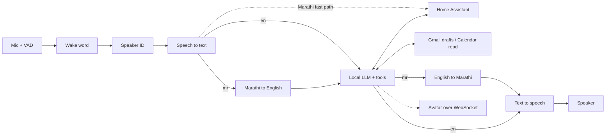

# Local AI Agent

A fully local, open-source voice assistant for the home. It speaks **Marathi and
English**, controls devices through **Home Assistant**, helps with email
(drafts only) and shows an animated face on a spare screen. Built on a desktop
GPU first, then ported to a **Jetson Orin Nano**.

The default persona is "Sasha", but it is **renamable**: the name, pronouns,
wake word, voice and languages all come from
[`AI_Agent/config/assistant.yaml`](AI_Agent/config/assistant.yaml). None of it
is hard-coded.

> **Status: Phase 0 done except the real-light gate; Phase 1 in progress.** Today it is a text-only CLI with
> an Ollama LLM, Home Assistant tools and per-request telemetry. The real-light
> test is still waiting for Home Assistant in Docker. There is no voice, face or
> Marathi support yet; see the roadmap.

## The idea: one brain, many devices

One **brain server** runs the LLM, speech models, tools, memory and permissions.
Small **satellite apps** on each device (laptops, PCs, a MacBook, the TV, a
Jetson) will handle wake word, mic, speaker and face, and talk to the brain over
home Wi-Fi. For now the brain is a laptop with an 8 GB GPU and everything runs on
that one machine; satellites are not built yet.

Planned product pieces:

- a **main window** with an animated face you talk to;
- **bots**: several named bots, each with its own model, instructions and
  connectors, each in its own chat;
- **settings with connectors**: how the assistant reaches tools. Home Assistant
  is built in. The plan is to support Model Context Protocol (MCP) servers so
  other connectors can be added. Gmail and Calendar stay drafts-only and
  read-only.

## Architecture



This is the voice loop on the brain (only the LLM and Home Assistant parts exist
today). Every stage sits behind a `typing.Protocol` in `AI_Agent/src/sasha/pipeline/`,
so models are swapped through hardware profiles (`config/profiles/pc.yaml`,
`jetson-orin-nano.yaml`) rather than code changes. Every request writes one JSON
line to `Data/logs/telemetry/` with per-stage latency, model versions, RAM/VRAM
and success.

## Roadmap

Each phase ends at a gate; the next one starts only when it passes, except
Phase 1, which started early on the owner's instruction while the Phase 0
real-light gate stays open (it must pass before the v0.1 release).

| Phase | What | State |
| --- | --- | --- |
| 0 | Text CLI, Ollama LLM, Home Assistant tool, telemetry | Done, except the real-light test |
| 1 | Brain server, window with face, bots, connectors, English voice | In progress |
| 2 | Marathi: IndicConformer, IndicTrans2, Indic Parler-TTS, fast path | Planned |
| 3 | Speaker ID and permissions, pets, camera | Planned |
| 4 | Gmail drafts, calendar, MCP connectors | Planned |
| 5 | Satellites on other devices, wake-word arbitration | Planned |
| 6 | Jetson Orin Nano port and backup brain | Planned |
| Later | 3D avatar, robot body | Ideas |

Details are in [`AI_reference/plan.md`](AI_reference/plan.md).
Alexa and Meta devices are closed platforms where audio or text would pass
through the vendor's cloud, so they are optional, later, and never part of the core.

## Privacy

**Today:**

- Everything runs locally on Ollama.
- Only `light`, `switch`, `fan`, `scene` and `media_player` can be controlled.
  Locks and alarms are refused in code.
- Device names and other fetched text are wrapped as untrusted data.
- Secrets live in `.env` and are never committed.

**Planned:**

- Audio is processed only after the wake word and is not saved by default.
- Sensitive actions need a spoken confirmation.

**Voice ID is convenience, not security.** It can be fooled by a recording or a
similar voice. Don't rely on it to guard anything that matters.

## Limitations

- No voice, face or Marathi yet. Marathi quality is untested.
- Model choices are measured on one laptop so far (8 GB GPU); the Jetson's 8 GB
  shared memory may not fit the full stack.
- Some device integrations (cloud-based lights) can lag or break.

## Quick start (Phase 0)

Requirements: Ubuntu 22.04 or 24.04 (or WSL2), Python 3.10, [uv](https://docs.astral.sh/uv/),
[Ollama](https://ollama.com/download/linux).

```bash
git clone https://github.com/abhinav-baroorkar/ai_agent.git && cd ai_agent
source AI_Agent/scripts/env.sh   # keeps the venv, uv and Hugging Face caches in Dependencies/; Ollama keeps its own model store
cp .env.example .env              # add HA_URL / HA_TOKEN for Home Assistant
cd AI_Agent
uv sync
uv run python scripts/download_models.py   # ollama pull for the profile's model
uv run sasha doctor                        # check Ollama + Home Assistant
uv run sasha chat --timing                 # talk to it
```

Use `--profile jetson-orin-nano` (or `SASHA_PROFILE`) to pick another profile,
and `chat --small` to run the profile's smaller comparison model.

### Rename the assistant

Edit `AI_Agent/config/assistant.yaml` (`name`, `pronouns`, `wake_word`, `voice`,
`languages`), or point `SASHA_ASSISTANT_CONFIG` at your own copy.

## Home Assistant safety

The LLM sees only three tools: `list_devices`, `get_state`, `call_service`.
They are limited to the domains and services in
[`config/tools.yaml`](AI_Agent/config/tools.yaml), with an optional entity
allowlist. Locks, alarms and anything unlisted can't be touched.

## Repository layout

| Folder | Contents |
| --- | --- |
| `AI_Agent/` | Code (`src/sasha/`), tests, config, bench, docker, scripts |
| `AI_reference/` | Plan, decisions, devlog, research notes |
| `User_reference/`, `Dependencies/`, `Data/` | Local only, git-ignored |

## Development

```bash
cd AI_Agent
uv run ruff check . && uv run ruff format --check . && uv run mypy && uv run pytest
```

Conventional commits and feature branches, reviewed locally, then merged into `main`. Max 400 lines per file.

## Models and licenses

Model weights are downloaded by script and never committed.

| Model | Used for | License |
| --- | --- | --- |
| Qwen3 8B / 4B (via Ollama) | LLM | Apache-2.0 |

More rows get added as models land (openWakeWord, faster-whisper,
IndicConformer, IndicTrans2, Indic Parler-TTS).

## License

[Apache-2.0](LICENSE)
