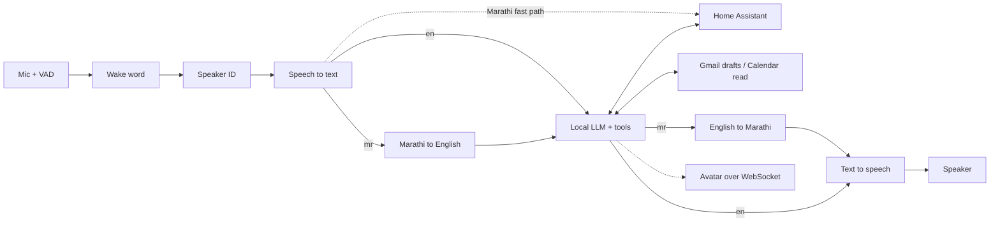

# Local AI Agent

A fully local, open-source voice assistant for the home. It speaks **Marathi and
English**, controls devices through **Home Assistant**, helps with email
(drafts only) and shows an animated face on a spare screen. Built on a desktop
GPU first, then ported to a **Jetson Orin Nano**.

The default persona is "Sasha", but it is **renamable**: the name, pronouns,
wake word, voice and languages all come from
[`AI_Agent/config/assistant.yaml`](AI_Agent/config/assistant.yaml). None of it
is hard-coded.

> **Status: Phase 0.** Text-only CLI with an Ollama LLM, Home Assistant tools and
> per-request telemetry. Voice comes next.

## Architecture



Every stage sits behind a `typing.Protocol` in `AI_Agent/src/sasha/pipeline/`,
so models are swapped through hardware profiles (`config/profiles/pc.yaml`,
`jetson-orin-nano.yaml`) rather than code changes. Every request writes one JSON
line to `Data/logs/telemetry/` with per-stage latency, model versions, RAM/VRAM
and success.

## Quick start (Phase 0)

Requirements: Ubuntu 22.04 (or WSL2), Python 3.10, [uv](https://docs.astral.sh/uv/),
[Ollama](https://ollama.com/download/linux).

```bash
git clone https://github.com/abhinav-baroorkar/ai_agent.git && cd ai_agent
source AI_Agent/scripts/env.sh   # keeps venv + model caches in Dependencies/
cp .env.example .env              # add HA_URL / HA_TOKEN for Home Assistant
cd AI_Agent
uv sync
uv run python scripts/download_models.py   # ollama pull for the profile's model
uv run sasha doctor                        # check Ollama + Home Assistant
uv run sasha chat --timing                 # talk to it
```

Use `--profile jetson-orin-nano` (or `SASHA_PROFILE`) to pick another profile,
and `chat --small` to run the profile's smaller comparison model.

### Rename the assistant

Edit `AI_Agent/config/assistant.yaml` (`name`, `pronouns`, `wake_word`, `voice`,
`languages`), or point `SASHA_ASSISTANT_CONFIG` at your own copy.

## Home Assistant safety

The LLM sees only three tools: `list_devices`, `get_state`, `call_service`.
They are limited to the domains and services in
[`config/tools.yaml`](AI_Agent/config/tools.yaml), with an optional entity
allowlist. Locks, alarms and anything unlisted can't be touched.

## Repository layout

| Folder | Contents |
| --- | --- |
| `AI_Agent/` | Code (`src/sasha/`), tests, config, bench, docker, scripts |
| `AI_reference/` | Plan, decisions, devlog, research notes |
| `User_reference/`, `Dependencies/`, `Data/` | Local only, git-ignored |

## Development

```bash
cd AI_Agent
uv run ruff check . && uv run ruff format --check . && uv run mypy && uv run pytest
```

Conventional commits, feature branches and PRs into `main`. Max 400 lines per file.

## Models and licenses

Model weights are downloaded by script and never committed.

| Model | Used for | License |
| --- | --- | --- |
| Qwen3 8B / 4B (via Ollama) | LLM | Apache-2.0 |

More rows get added as models land (openWakeWord, faster-whisper,
IndicConformer, IndicTrans2, Indic Parler-TTS).

## License

[Apache-2.0](LICENSE)
